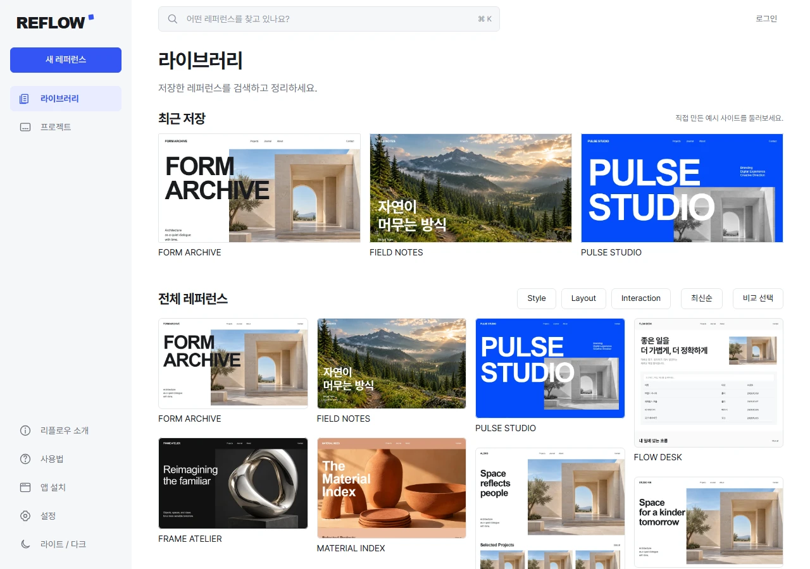

<p align="center">
  
</p>

<h1 align="center">REFLOW · 리플로우</h1>

<p align="center">
  웹 디자인 레퍼런스를 수집하고, 분류하고, 프로젝트에 활용하는 개인 작업 도구입니다.<br>
  <a href="https://reflow.tnfh23.workers.dev"><strong>서비스 열기</strong></a> ·
  <a href="#실행"><strong>로컬 실행</strong></a> ·
  <a href="docs/code-map.md"><strong>코드 구조</strong></a> ·
  <a href="docs/cloud-setup.md"><strong>클라우드 연결 안내</strong></a>
</p>

<p align="center">
  
  
  
</p>

## 소개

좋은 웹사이트를 발견해도 주소만 저장하면 어떤 부분을 참고하려 했는지 잊기 쉽습니다. REFLOW는 사이트 주소와 전체 화면, 필요한 구간, 개인 메모를 함께 보관하기 위해 만들었습니다.

라이브러리에서 자료를 찾고, 상세 화면에서 디자인과 동작을 확인하고, 필요한 부분을 프로젝트 보드에 담습니다. 단순한 링크 목록보다 수집한 자료를 다시 사용하는 과정에 집중했습니다. UI와 안내는 한국어로 제공합니다.

[공개 리플로우](https://reflow.tnfh23.workers.dev)에서 예시를 탐색하고 Google 계정으로 개인 자료를 저장할 수 있도록 연결했습니다. Google 로그인·예시 개인 복사·메모 저장·프로젝트 생성과 추가를 공개 앱에서 확인했습니다. 자체 도메인은 시험 운영 뒤 검토합니다.

## 주요 기능

공개 버전과 로컬 버전의 공통 기능을 설명하며 차이는 해당 항목에 표시합니다.

### 레퍼런스 수집

- **주소 저장과 캡처**: 웹사이트 주소를 저장하면 실제 브라우저로 전체 페이지와 주요 구간을 캡처합니다. 로딩 화면이 사라지고 콘텐츠가 준비된 후 저장하며 지연 로딩 이미지도 활성화합니다.
- **작업 상태 확인**: 다른 화면으로 이동해도 캡처가 이어지며, 완료·실패 상태를 확인하고 재시도할 수 있습니다.
- **이미지 업로드**: 직접 이미지를 올리고 필요한 영역을 선택해 구간으로 저장합니다.
- **예시 라이브러리**: 직접 제작한 가상 사이트 8개를 둘러보고 원하는 항목만 내 라이브러리에 복사합니다. 복사 후 편집은 예시 원본에 영향을 주지 않습니다.

### 분류와 메모

- 제목·설명·분류 태그를 편집하고 참고할 내용을 메모합니다.
- 제목·태그·설명·구간·메모를 키워드로 검색하고 어떤 내용이 일치했는지 확인합니다.
- 전체 화면과 구간을 확대해 볼 수 있습니다. 왼쪽 구간 목록으로 원하는 부분을 선택합니다.
- 현재 검색은 키워드 검색입니다. AI 의미 검색은 아직 연결하지 않았습니다.

### 디자인과 동작 확인

- 캡처에서 읽은 색상과 CSS 타이포 정보를 표시합니다.
- 로컬 캡처와 제작 예시에는 제한된 스크롤·호버·메뉴·탭의 실제 변화 전후 화면이 있습니다. 공개 서버의 새 URL 캡처는 현재 전체 화면·구간·CSS 정보까지 제공합니다.
- 정적 업로드 이미지에서 모션이나 글꼴을 추측하지 않습니다. 관찰하지 못한 동작은 확인한 결과로 표시하지 않습니다.

### 비교와 프로젝트 보드

- **두 자료 비교**: 레퍼런스 두 개를 함께 열고 화면과 구간을 비교합니다.
- **프로젝트에 담기**: 전체 화면·구간·직접 선택한 영역을 프로젝트 보드에 추가합니다.
- **보드 정리**: 섹션을 만들고 자료를 드래그하거나 이동 메뉴로 정리합니다.
- **이미지 보존**: 레퍼런스를 다시 캡처해도 보드의 기존 이미지를 자동으로 바꾸지 않습니다. 라이브러리에서 제거한 자료도 프로젝트에 담은 이미지는 유지합니다.

### 계정과 저장

- 로그인 없이 자체 예시를 탐색하고, Google 계정으로 개인 레퍼런스·메모·프로젝트를 저장합니다.
- 공개 앱은 Supabase의 개인 DB·이미지 저장소를 사용합니다. 다른 사용자에게 개인 자료를 공개하지 않습니다.
- 다른 기기에서 같은 계정으로 로그인해 저장한 자료를 불러올 수 있도록 연결했습니다. 실기기 교차 접속 검증은 별도입니다.
- 로컬 버전의 이메일 계정·SQLite·이미지는 이 PC에 남으며 자동 이관하지 않습니다.

### 소개와 사용법

- 사이드바의 **소개**에서 서비스 설명과 자동 반복 모션 그래픽을 볼 수 있습니다. 글자 순차 등장, 섹션 등장, 전체 폭 마퀴를 적용했습니다.
- **사용법**에서는 저장·기록·비교·프로젝트 활용을 단계별로 연습하고 단축키·FAQ를 확인합니다. 연습 화면은 실제 자료를 저장하지 않습니다.
- 라이트·다크 테마, 반응형 화면, 키보드 조작, 움직임 감소 설정을 지원합니다.

### 앱 설치(PWA)

- 지원 브라우저에서 사이드바의 **앱 설치**로 별도 앱 창을 열 수 있습니다. 설치 요청을 지원하지 않는 브라우저에는 기기별 방법을 안내합니다.
- 별도 실행 파일이나 앱스토어 배포판이 아닌 PWA 방식입니다. 공개 설치판의 자료 저장·캡처·편집에는 인터넷 연결이 필요합니다. 로컬 설치판은 실행 중인 로컬 서버도 필요합니다.
- 빌드된 앱에서 한 번 준비한 앱 셸과 사용법은 오프라인으로 읽을 수 있습니다. 개인 이미지와 API 응답은 서비스 워커에 캐시하지 않습니다.
- 업데이트는 작성 중인 화면을 강제로 새로고침하지 않고 앱 창을 모두 닫았다가 다시 열 때 적용합니다.
- 설정에서 OS 알림을 허용하면 리플로우가 열려 있는 동안 캡처 완료·실패와 프로젝트 변경을 알립니다. 서버 푸시 구독은 없으며 앱을 닫으면 새 알림이 오지 않습니다.
- 로그인 전에도 [이용약관](https://reflow.tnfh23.workers.dev/terms.html)과 [개인정보처리방침](https://reflow.tnfh23.workers.dev/privacy.html)을 읽을 수 있습니다. 공개 로그인 화면에는 실제 연결된 Google만 표시합니다.

> Plus X는 실제 원격 캡처를 확인했습니다. 외부 사이트의 로그인·봇 차단·동적 구성에 따라 다른 캡처는 실패할 수 있습니다. 모든 인터랙션을 자동으로 발견하는 기능은 아닙니다. 실제 모바일 기기와 운영체제의 PWA 설치는 별도 검증이 남아 있습니다.

## 기술 스택

| 영역 | 사용 기술 |
| --- | --- |
| 프런트엔드 | React 19, Vite 8, JavaScript / JSX |
| 인터랙션 | GSAP, ScrollTrigger, SplitText, Lenis |
| 로컬 서버와 저장 | Express 5, Node.js SQLite, 로컬 이미지 파일 |
| 캡처와 이미지 처리 | Playwright, Sharp |
| 앱 설치 | Web App Manifest, Service Worker |
| 클라우드 서버 | Supabase Auth / PostgreSQL / Storage, Cloudflare Workers / Browser Run |
| 검증 | Node.js 테스트, PGlite 정책 검사, 실제 브라우저 조작 |

## 실행

Node.js 24 이상을 사용합니다. 현재 프로젝트 경로는 `C:\Reflow`입니다.

```powershell
cd C:\Reflow
npm ci
npx playwright install chromium
npm run dev
```

개발 화면은 [127.0.0.1:4182](http://127.0.0.1:4182/), 로컬 API는 4183에서 실행합니다. 이미 의존성과 브라우저를 설치했다면 `npm run dev`로 시작하면 됩니다.

빌드된 앱과 PWA를 확인하려면 다음 명령을 사용합니다.

```powershell
npm run build
npm start
```

[리플로우 열기](http://127.0.0.1:4183/) · [소개](http://127.0.0.1:4183/#about) · [사용법](http://127.0.0.1:4183/#guide)

위 localhost 주소는 이 PC 전용입니다. 휴대폰과 다른 기기에서는 [공개 HTTPS 주소](https://reflow.tnfh23.workers.dev)를 사용합니다.

## 개발 명령어

| 명령어 | 내용 |
| --- | --- |
| `npm ci` | 잠금 파일 기준으로 의존성 설치 |
| `npx playwright install chromium` | 로컬 캡처에 사용할 브라우저 설치 |
| `npm run dev` | UI와 로컬 API 개발 서버 실행 |
| `npm run build` | 웹앱 빌드 |
| `npm start` | 빌드된 웹앱과 로컬 API 실행 |
| `npm run seed` | 4182 개발 서버의 예시 페이지를 캡처해 로컬 예시 준비 |
| `npm run check` | 로컬 서버 진입점과 캡처 모듈 구문 검사 |
| `npm run docs:check` | 파일 역할표의 누락·삭제·중복·미검토 변경 확인 |
| `npm run docs:stamp` | 코드와 역할 설명을 검토한 뒤 검토 기준 기록 |
| `npm run test:cloud` | 클라우드 인증·세션 테스트 |
| `npm run test:cloud:db` | 메모리 PostgreSQL에서 데이터 접근 정책 검사 |
| `npm run test:cloud:api` | 클라우드 API 흐름 테스트 |
| `npm run test:cloud:media` | 비공개 이미지 처리 어댑터 테스트 |
| `npm run test:cloud:limits` | 캡처 동시성·용량·네트워크 접근 제한 검사 |
| `node --test tests/capture*.test.mjs` | 로딩·화면 안정·영상 응답 제한 회귀 검사 |
| `npm run test:cloud:uploads` | multipart 업로드·크롭·한도 거절 검사 |
| `npm run check:cloud` | 클라우드 설정 형식 검사 |
| `npm run cloud:preview` | Worker를 로컬에서 실행 |
| `npm run cloud:bundle` | Worker 배포 파일 확인, 실제 배포는 하지 않음 |

## 서비스 연결 상태

| 항목 | 현재 상태 |
| --- | --- |
| 로컬 저장·캡처·검색·보드 | 구현 및 핵심 흐름 검증 완료 |
| Supabase | Free 프로젝트에 DB·사용자별 접근 정책·이미지 저장소 기반 적용 |
| Google 로그인 | 공개 앱과 로그인 복귀 주소 연결. 실제 Google 로그인·복귀·개인 메모 저장 확인 |
| Cloudflare | 무료 Worker·정적 앱·지속 캡처 큐·원격 캡처·이미지 업로드 연결 및 공개 배포 |
| 다른 기기 접속 | 같은 Google 계정의 서버 자료를 불러오도록 연결. 실기기 검증은 별도 |
| Google 검색 등록 | 확인 HTML·robots·사이트맵 배포. Search Console 소유권 확인·사이트맵 제출 접수 완료. 홈페이지 색인 요청 접수 완료. 사이트맵 처리와 실제 검색 노출은 확인 중 |
| AI 분석·의미 검색 | 제공자 미연결, 외부 AI API 호출하지 않음 |

유료 플랜·AI API·자체 도메인은 구매하지 않았습니다. 무료 기본 주소로 시험 운영합니다. 캡처는 서비스 전체 하루 10회·계정별 3회, 이미지 누적 저장은 계정별 25MB로 제한합니다. 서버 전체 저장 제한 또는 제공자 무료 한도에 도달하면 작업을 중단하고 URL·기존 자료는 유지합니다. 초기 무료 한도와 배포 절차는 [클라우드 연결 안내](docs/cloud-setup.md)에 정리했습니다.

## 코드 구조와 작업 문서

[파일 역할과 기능 흐름](docs/code-map.md)은 화면·훅·서버·DB·설정·테스트 파일이 무엇을 맡는지 표로 설명합니다. 기능을 수정할 때 `AGENTS.md`와 프로젝트의 `code-map` 스킬에 따라 관련 설명도 함께 갱신합니다. 검사기는 누락과 미검토 변경을 찾으며 역할 설명을 자동 작성하는 기능은 아닙니다.

[화면 흐름](docs/screen-flow.md) · [디자인 콘셉트](design/brief.md) · [인터랙션 계획](design/motion-map.md) · [구현 기준](design/implementation-spec.md) · [검토 기록](design/review.md)

## 제작 방식과 자산

OpenAI Codex, 사용자 frontend-experience 워크플로와 Build Web Apps를 사용해 콘셉트·디자인·구현·실제 화면 검증을 진행했습니다.

예시 사이트 8개는 직접 만든 가상 HTML/CSS 사이트입니다. 건축·숲·조형물·세라믹 사진은 imagegen으로 생성했으며, 해당 사진을 넣은 실제 페이지를 브라우저로 캡처했습니다. 상단 이미지는 실제 REFLOW 예시 라이브러리 화면입니다.

본문과 UI의 Pretendard는 SIL Open Font License로 사용하며 [라이선스](public/fonts/LICENSE.txt)를 포함합니다. 개인 데이터·비밀키·토큰은 공개 문서에 넣지 않습니다.

